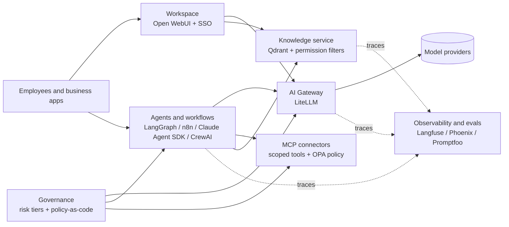

# Aurai

**One governed path from idea to production AI.**

Aurai is the enterprise AI platform for **Amazing-Enterprise**, a global entertainment and experiences company. It gives every business unit (parks and experiences, studios, consumer products, marketing, corporate functions) a single, governed way to use AI models, build agents and workflows, ground answers in company knowledge, and prove that what they ship is safe and valuable.

This repository is the product front door: vision, requirements, roadmap, metrics, rollout plan, architecture and governance. The platform itself lives in the sibling `aurai-*` repositories listed below.

> Amazing-Enterprise is a fictional company. All data, personas and scenarios in these repositories are synthetic.

---

## What Aurai provides

| Capability | What teams get | Repository |
|---|---|---|
| **AI Gateway** | One API to many models, per-team keys, budgets, rate limits, fallbacks, PII masking | `aurai-gateway` |
| **Workspace** | A secure chat environment for employees, with roles, audit logging and document Q&A | `aurai-workspace` |
| **Agents & Workflows** | Governed agent runtime with approval gates, plus low-code workflows for business users | `aurai-agent-runtime` |
| **Knowledge (RAG)** | Permission-aware retrieval over company documents, with citations | `aurai-knowledge-rag` |
| **Tools (MCP)** | Vetted, scoped connectors that let agents act on enterprise systems | `aurai-mcp-connectors` |
| **Evals & Governance** | Tracing, quality gates, risk tiers and policy-as-code from pilot to production | `aurai-eval-governance` |
| **Infrastructure** | Kubernetes (Helm) and Terraform (AWS) foundations | `aurai-infra` |

## Architecture at a glance

See [docs/architecture/overview.md](docs/architecture/overview.md) for the full picture.

## Repository map and build order

| # | Repository | Purpose | Status |
|---|---|---|---|
| 0 | `aurai-docs` (this repo) | Product docs, architecture, governance | Built |
| 1 | `aurai-infra` | Helm charts, Terraform (AWS), CI templates | Built (prototype) |
| 2 | `aurai-gateway` | LiteLLM configuration, budgets, guardrails | Built (prototype) |
| 3 | `aurai-eval-governance` | Tracing, risk tiers, evals, promotion gates | Built (prototype) |
| 4 | `aurai-workspace` | Open WebUI configuration, roles, SSO | Built (prototype) |
| 5 | `aurai-knowledge-rag` | Ingestion, Qdrant retrieval, citations | Built (prototype) |
| 6 | `aurai-mcp-connectors` | MCP servers with policy checks | Built (prototype) |
| 7 | `aurai-agent-runtime` | Agents and workflows with approval gates | Built (prototype) |

Details and dependencies: [docs/repositories.md](docs/repositories.md). What is built, what is verified and what differs from the plan: [docs/status.md](docs/status.md).

## Technology stack

LiteLLM · Open WebUI · Keycloak · LangGraph · n8n · Claude Agent SDK · CrewAI · MCP (Python SDK) · Open Policy Agent · Qdrant · Presidio · Langfuse · Phoenix · Promptfoo · OpenTelemetry · Kubernetes (Helm) · Terraform (AWS)

Rationale and rejected alternatives: [docs/architecture/stack.md](docs/architecture/stack.md).

## Documentation index

**Product**
- [Vision and positioning](docs/product/vision.md)
- [Personas](docs/product/personas.md)
- [Product requirements (PRD)](docs/product/prd.md)
- [Roadmap](docs/product/roadmap.md)
- [OKRs and KPIs](docs/product/okrs-and-kpis.md)
- [Pilot and rollout plan](docs/product/pilot-and-rollout.md)
- [Adoption funnel](docs/product/adoption-funnel.md)

**Architecture**
- [Overview](docs/architecture/overview.md)
- [Prototype vs. production](docs/architecture/prototype-vs-production.md)
- [Build status and verification](docs/status.md)
- [Stack and rejected alternatives](docs/architecture/stack.md)
- [Architecture decision records](docs/architecture/decisions/)

**Governance**
- [Risk tiers](docs/governance/risk-tiers.md)
- [Data, PII and IP principles](docs/governance/data-and-pii-principles.md)

## License

MIT. See [LICENSE](LICENSE).
