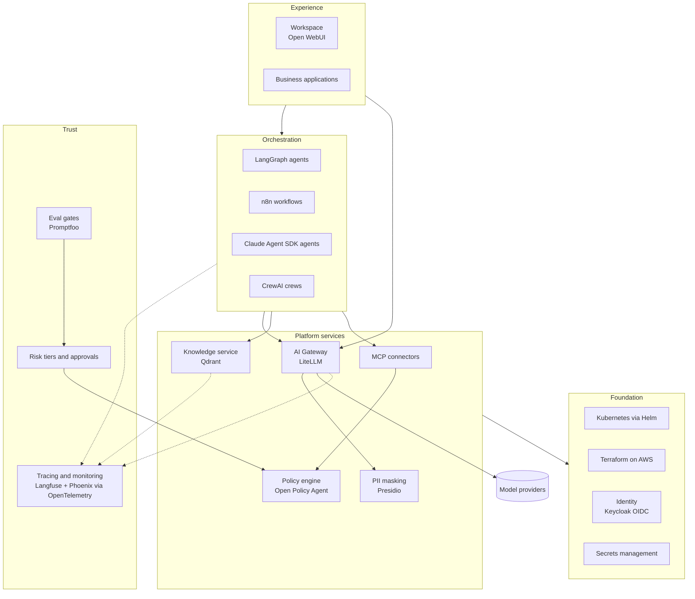

# Architecture overview

## Layers

## Request flow: grounded answer
1. User signs in through Keycloak and asks a question in the workspace.
2. The workspace calls the knowledge service with the user identity.
3. The knowledge service retrieves from Qdrant, filtering by the user's entitlements.
4. The prompt and retrieved passages go to the gateway; Presidio masks PII where required.
5. The gateway routes to the configured model, applying budget and rate limits, and falls back if needed.
6. The answer returns with citations; the whole chain is traced.

## Request flow: agent action
1. An agent plans a step that needs a tool.
2. The tool call goes to an MCP connector; Open Policy Agent allows or denies based on team, risk tier and action.
3. If the action is consequential, the agent pauses for human approval.
4. After approval, the connector executes; result and approval are traced and audited.

## Cross-cutting concerns
- **Identity:** OIDC for users; scoped service identities for agents and connectors.
- **Observability:** every model call, retrieval and tool call emits OpenTelemetry traces to Langfuse and Phoenix.
- **Cost:** gateway spend tracking by team key, reported in dashboards.
- **Governance:** each use case has a risk tier that sets controls, eval requirements and approvals (see [risk tiers](../governance/risk-tiers.md)).
- **Resilience:** gateway is stateless behind a load balancer; model fallbacks tested in CI.
