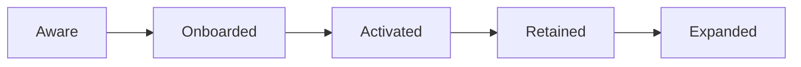

# Adoption funnel

The funnel tracks teams, then users within teams. It shows where the platform loses people and tells us what to fix.

| Stage | Definition | Signal | Typical cause of drop-off |
|---|---|---|---|
| **Aware** | Team knows Aurai exists and what it offers | Intake form views, enablement attendance | Weak communication |
| **Onboarded** | Team has an owner, risk tier, key, budget and access | Gateway admin records | Slow approval; unclear process |
| **Activated** | A use case has run end to end and passed its first eval | Governance and eval records | Hard to start; missing templates |
| **Retained** | Team still active after 30 and 90 days | Request volume, weekly active users | Low value; poor answer quality |
| **Expanded** | Team has added use cases, users or connectors | New use cases per team | Limited connectors; cost concerns |

## User-level metrics inside a team
- Share of invited users who made a first request within a week
- Weekly active users and requests per active user
- Share of requests that use knowledge or tools, not plain chat
- Helpfulness feedback rate and score

## Instrumentation
- Gateway: requests, tokens, cost, errors by team key.
- Workspace: sign-ins, sessions, feature use.
- Tracing (Langfuse, Phoenix): quality, latency, tool use by use case.
- Governance records: tier decisions and approval times.

## How the funnel is used
- Reviewed weekly during pilot waves.
- Every stage with a large drop gets an owner and an action.
- Results feed the roadmap and the monthly OKR review.
